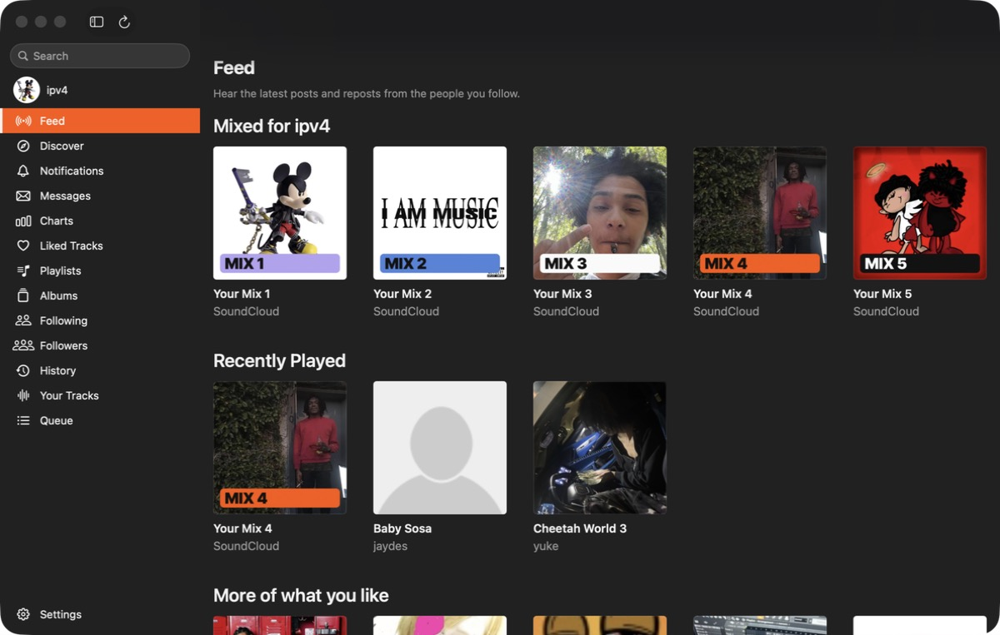
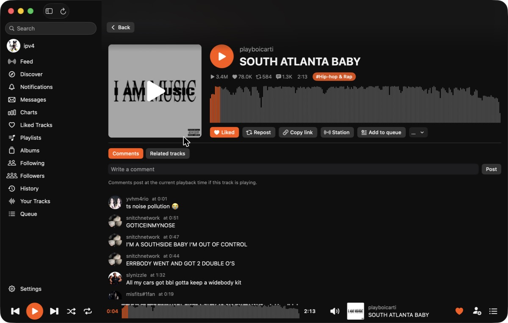
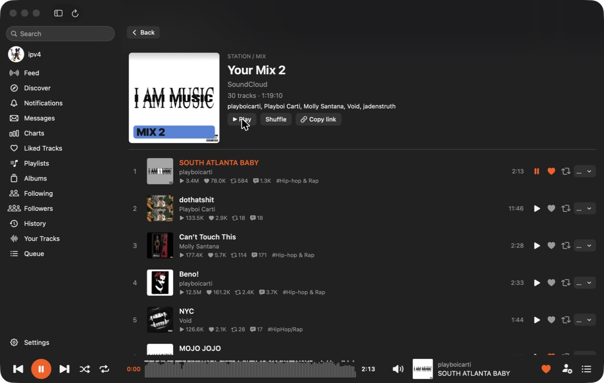
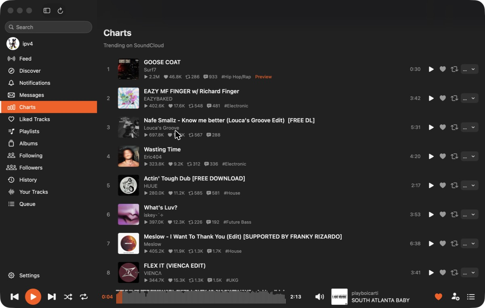
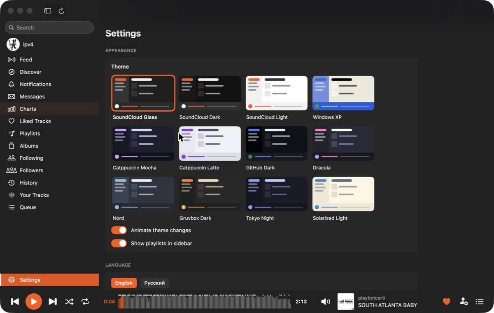
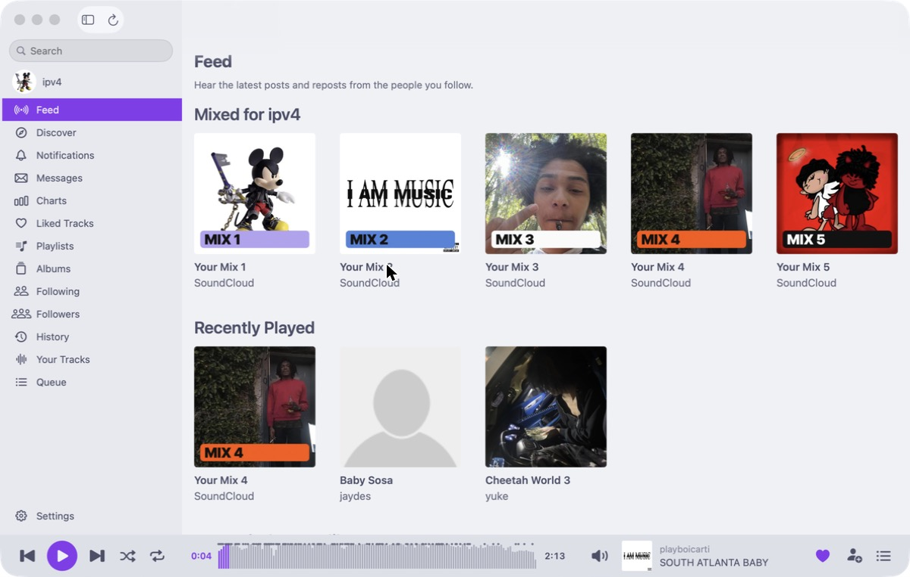

# SCDesktop

A native macOS client for SoundCloud, written in Swift and SwiftUI. No Electron, no web view, no third-party dependencies.



## Features

**Listening**
- Feed of posts and reposts from people you follow, plus your mixes and recently played
- Discover, Charts (trending), and Search across tracks, people, playlists and albums
- Station radio from any track, and autoplay of related tracks when the queue runs out
- Queue with shuffle, repeat (off / all / one), seek, volume and mute
- Waveform seek bar with timed comment markers
- Media keys, Now Playing in Control Center, and the macOS menu bar (Playback and Go menus)

**Your library**
- Liked tracks, Playlists and Albums: create playlists, add or remove tracks, delete playlists
- Following, Followers, History and Your Tracks
- Like, repost and follow from any list; changes show instantly
- Notifications and Messages (direct conversations)

**Pages**
- Track page with comments (post your own at the current playback time) and related tracks
- User pages: tracks, popular, playlists, albums, reposts, likes
- Copy link, copy embed code, add to queue, start a station

**App**
- 12 themes, including SoundCloud Glass (Liquid Glass on macOS 26), SoundCloud Dark/Light, Windows XP, Catppuccin, GitHub Dark, Dracula, Nord, Gruvbox, Tokyo Night and Solarized Light
- English and Russian interface
- API server picker (`api-v2`, `api-mobi` or automatic by latency)
- soundcloud.com-style keyboard shortcuts
- Responses cached for 5 minutes on disk, so pages open instantly and stay readable offline

## Screenshots

| Track page | Playlist |
|---|---|
|  |  |

| Charts | Themes |
|---|---|
|  |  |

Catppuccin Latte theme:



## Requirements

- macOS 14 Sonoma or later (Liquid Glass needs macOS 26; older systems get standard vibrancy)
- A SoundCloud account
- To build: Swift 5.10+ (Xcode 15.3+ or the Command Line Tools). Building against the macOS 26 SDK (Xcode 26) enables Liquid Glass.

## Install

### Build the app

```bash
git clone https://github.com/ohmygodsummrs/soundcloud-desktop-macos.git
cd soundcloud-desktop-macos
Scripts/make-app.sh
```

This produces `build/SCDesktop.app` (release build, ad-hoc signed, icon included). Drag it to `/Applications`.

`make-app.sh` uses `/Applications/Xcode.app` by default. To use another toolchain, set `DEVELOPER_DIR`:

```bash
DEVELOPER_DIR=/Library/Developer/CommandLineTools Scripts/make-app.sh
```

### Run without bundling

```bash
swift run SCDesktop
```

### Downloaded a prebuilt copy?

The app is ad-hoc signed, not notarized, so Gatekeeper blocks it on first launch. Right-click the app → **Open**, or remove the quarantine flag:

```bash
xattr -dr com.apple.quarantine /Applications/SCDesktop.app
```

## Sign in

SCDesktop uses your existing soundcloud.com session; it never sees your password.

1. Sign in at [soundcloud.com](https://soundcloud.com) in your browser.
2. Open DevTools (⌥⌘I) → **Application** (Chrome) or **Storage** (Safari/Firefox) → **Cookies** → `https://soundcloud.com`.
3. Copy the value of the `oauth_token` cookie.
4. Paste it into SCDesktop's sign-in screen.

The token is stored in `~/Library/Application Support/SCDesktop/token` with permissions `0600` (only your user can read it). Signing out deletes it. Treat the token like a password: anyone who has it can act as your account.

## Keyboard shortcuts

The same single-key shortcuts as soundcloud.com. They are ignored while typing in a text field.

| Key | Action |
|---|---|
| Space | Play / pause |
| ← / → | Seek 5 seconds back / forward |
| ⇧← / ⇧→ | Previous / next track |
| ⇧↑ / ⇧↓ | Volume up / down |
| 0 – 9 | Jump to 0% – 90% of the track |
| M | Mute |
| L | Like current track |
| R | Repost current track |
| S | Toggle shuffle |
| Q | Show queue |
| / | Focus search |
| G then S / L / P / H / F / Q | Go to Feed / Likes / Playlists / History / Following / Queue |
| ⌘R | Refresh current page |

## Where data lives

| What | Where |
|---|---|
| OAuth token | `~/Library/Application Support/SCDesktop/token` |
| API and image cache | `~/Library/Caches/SCDesktop/` |
| Preferences (theme, language, volume, server, …) | `defaults read dev.local.SCDesktop` |

To reset the app completely, quit it and delete those three.

## Limitations

- SCDesktop uses SoundCloud's private web API (`api-v2.soundcloud.com`), the same one soundcloud.com uses. It is undocumented and can change without notice.
- The API `client_id` is read from soundcloud.com's JavaScript and cached. If SoundCloud changes how they ship it, sign-in and playback stop working until the app is updated.
- Some SoundCloud Go+ tracks use DRM/encrypted streams that AVPlayer cannot play. They are skipped automatically; 30-second previews are labeled.
- Uploading tracks is not supported.

## Development

```bash
swift build                       # debug build
SC_DEBUG=1 swift run SCDesktop    # log every API request and response to stderr
SC_PERF=1 swift run SCDesktop     # log slow frames and show the Metal HUD
```

The whole app is in `Sources/SCDesktop/`. [ARCHITECTURE.md](ARCHITECTURE.md) maps every file and has recipes for adding pages, endpoints and settings. [AGENTS.md](AGENTS.md) lists the code conventions and known gotchas.

## License

[MIT](LICENSE)

## Disclaimer

SCDesktop is an unofficial, independent project. It is not affiliated with, endorsed by, or sponsored by SoundCloud. SoundCloud is a trademark of SoundCloud Global Limited & Co. KG. Use it in line with SoundCloud's Terms of Use.
